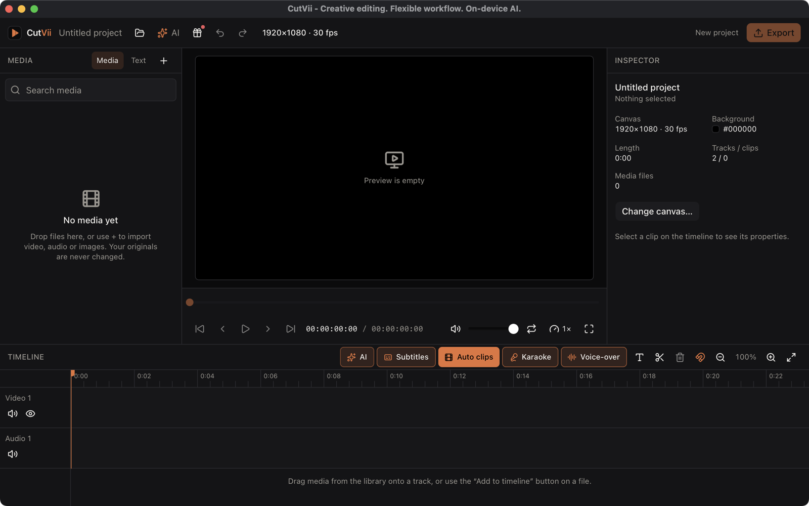

<p align="center">
  
</p>

<h1 align="center">CutVii</h1>

<p align="center"><b>Creative editing. Flexible workflow. On-device AI.</b><br>Version 1.0.0</p>

<p align="center">
  <a href="https://github.com/zidniryi/cutvii/releases/latest"></a>
  <a href="https://github.com/zidniryi/cutvii/releases"></a>
  <a href="https://github.com/zidniryi/cutvii/actions/workflows/ci.yml"></a>
</p>

<p align="center">
  
</p>

<p align="center">
  
</p>

An open-source, cross-platform desktop video editor: **import → edit on a multi-track timeline → preview → export MP4**.
Local-first and offline: no account, no analytics, your media is never modified or uploaded. The one thing
CutVii can download, and only when you ask and confirm, is a speech model for auto subtitles.

Text is drawn with 38 bundled font families (37 under the SIL Open Font License 1.1, Luckiest Guy under Apache 2.0),
including the heavy display face Anton (OFL 1.1, © 2020 The Anton Project Authors). The licence texts are in
`src-tauri/assets/fonts/licenses/`; see `docs/licensing.md`.

> Status: desktop MVP (Phases 1–7). Developed and tested on macOS (Apple Silicon). Windows and Linux are built in
> CI but have not been run by hand yet. Android is planned (Phase 8).

## Features

- Import video, audio and images (probed with FFprobe, thumbnails cached).
- Multi-track timeline: move, trim, split at playhead, delete, snapping, zoom, context menu, undo/redo.
- Track mute / hide, per-clip volume (0–200 %), Start / Duration fields in the inspector.
- Preview with play/pause/scrub that follows the timeline across clips.
- Save and reopen projects (`.cutvii`, versioned JSON with migrations), missing-media detection and relink.
- Export H.264/AAC MP4 (resolution, frame rate, quality), with progress, cancel and ffprobe verification.
- Audio-only export: M4A, MP3 or WAV.

## Install and run (development)

Requirements:

| Tool              | Version                                                         |
| ----------------- | --------------------------------------------------------------- |
| Node.js           | 22+                                                             |
| pnpm              | 10+ (`corepack enable`)                                         |
| Rust              | stable (1.85+)                                                  |
| FFmpeg + FFprobe  | 6+ with an H.264 encoder (libx264, libopenh264 or VideoToolbox) |
| Tauri system deps | see <https://tauri.app/start/prerequisites/>                    |

```bash
pnpm install
pnpm tauri dev        # run the app
```

CutVii never assumes a global FFmpeg. It looks, in order, at `CUTVII_FFMPEG` / `CUTVII_FFPROBE`, then `PATH`
(plus `/opt/homebrew/bin` and `/usr/local/bin` on macOS). If nothing is found you get a clear error on import.

```bash
brew install ffmpeg                 # macOS
sudo apt install ffmpeg             # Debian / Ubuntu
choco install ffmpeg                # Windows
```

## Scripts

| Command                                              | What it does                                                                    |
| ---------------------------------------------------- | ------------------------------------------------------------------------------- |
| `pnpm typecheck` / `pnpm lint` / `pnpm format:check` | static checks                                                                   |
| `pnpm test`                                          | frontend tests (Vitest + Testing Library)                                       |
| `cd src-tauri && cargo test`                         | Rust tests, including real FFmpeg renders (skipped loudly if FFmpeg is missing) |
| `pnpm tauri build`                                   | release build and installers                                                    |

## Keyboard shortcuts

Space play/pause · S split at playhead · Delete/Backspace delete · Ctrl/Cmd+Z undo · Ctrl/Cmd+Shift+Z redo ·
Ctrl/Cmd+S save · Ctrl/Cmd+Shift+S save as · Ctrl/Cmd+O open · ←/→ seek one frame (Shift: one second) · Home to start.
Shortcuts are ignored while typing in an input.

## Documentation

- [`docs/project-schema.md`](docs/project-schema.md) — project file format, validation, migrations, save/open safety.
- [`docs/export-rules.md`](docs/export-rules.md) — exactly how the timeline becomes a video.
- [`docs/preview-limits.md`](docs/preview-limits.md) — what the preview does and where it is approximate.
- [`docs/licensing.md`](docs/licensing.md) — **FFmpeg licensing** and dependency licences. Read before distributing.
- [`docs/smoke-tests.md`](docs/smoke-tests.md) — per-OS manual test checklist and what has actually been verified.

## Project layout

```
src/              React + TypeScript UI (components, stores, timeline engine, playback, export dialog)
src-tauri/src/    Rust: commands/, media/ (ffmpeg, probe, import), project/ (model, validation, persistence), export/
fixtures/         project-v1.json, shared by the TS and Rust tests so the schemas stay in sync
design/           source artwork for the app icon (`pnpm tauri icon design/app-icon.png` regenerates the set)
```

## Security

The webview can only reach Rust through a small set of typed commands. File dialogs run in Rust, so the webview
never supplies a path to read or write; the asset protocol is limited to the thumbnail cache plus files you
imported or opened; a strict Content-Security-Policy is set for production builds.

## Update check

CutVii can tell you when a newer release exists on GitHub. It is a notification only: nothing is downloaded
or installed, and "Download" just opens the release page in your browser.

- It is optional: turn off "Check for updates automatically" in Settings and no request is made at all.
- When it is on, CutVii asks GitHub's releases API at most once every 24 hours, a few seconds after start.
- The request carries nothing about you or your projects, only `User-Agent: CutVii/<version>`. As with any
  request, GitHub sees your IP address.
- The repository to ask is one constant, `UPDATE_REPO` in `src-tauri/src/commands/update.rs`; it is
  `zidniryi/cutvii`.

## Contributing

Contributions are welcome. See [CONTRIBUTORS.md](CONTRIBUTORS.md) for how to help and who has.

## Licence

CutVii is released under the [MIT License](LICENSE). Third-party fonts and dependencies keep their own licences;
see `docs/licensing.md` for the constraints (FFmpeg is not bundled, MPL-2.0 crates are used unmodified).
